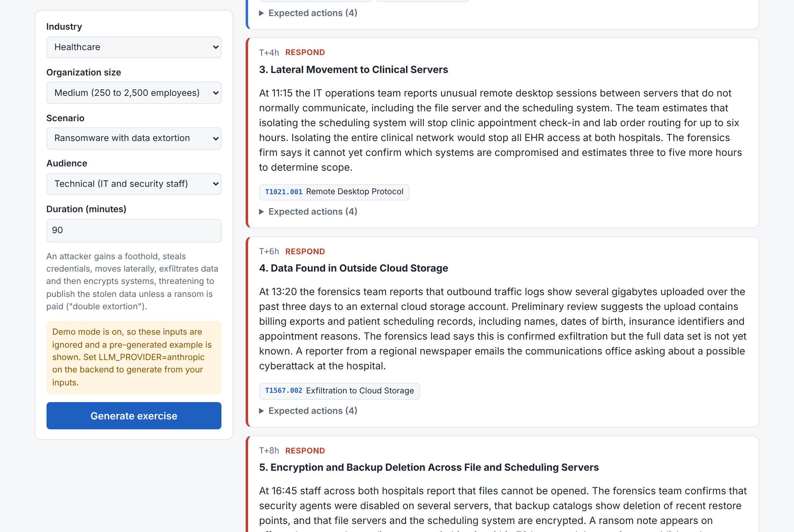
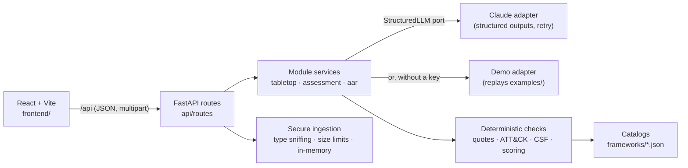
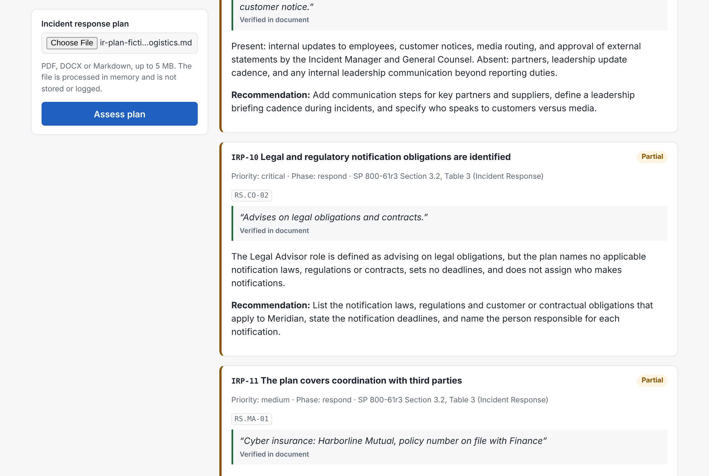

# IR Readiness Copilot

[](https://github.com/DevResident/IR-Readiness/actions/workflows/ci.yml)

AI-assisted incident response readiness for consultants: assess an IR plan, generate a tabletop exercise,
and turn the exercise notes into an after-action report. Everything is mapped to **NIST SP 800-61 Rev. 3**,
**NIST CSF 2.0** and **MITRE ATT&CK**, and every framework reference and quote the model produces is
verified by deterministic code before anyone sees it.



## The problem

Proactive incident response work (plan reviews, tabletop exercises, after-action reports) is
document-heavy and repetitive, and it has to be precise: a report that cites a technique ID that does not
exist, or claims a plan covers something it does not, damages the client's trust. Large language models
draft this material well but invent identifiers and evidence. This project uses the model for drafting and
code for verification.

## Features

| Module | Input | Output | What code verifies |
|---|---|---|---|
| **IR Plan Readiness Assessment** | A plan as PDF, DOCX or Markdown | Met / partial / missing for 23 controls, with quotes, recommendations, a weighted score and the top gaps | Every quote is searched for in the document; an unverified quote downgrades the control. Score and coverage are computed in code. |
| **Tabletop Exercise Generator** | Industry, size, scenario (ransomware, BEC, insider, supply chain), audience | Narrative, timed injects, roles, questions per phase, facilitator guide | Every ATT&CK ID is checked against the pinned v20.0 catalog: invented IDs are dropped, revoked ones remapped to MITRE's successor. CSF categories are validated. |
| **After-Action Report** | Exercise or incident notes | Executive summary, strengths, areas for improvement, gaps, recommendations ranked by priority with suggested owners; DOCX, Markdown and PDF export | Every observation's quote is searched for in the notes; CSF categories and recommendation-to-observation links are validated. |

Each response carries a `validation` section listing what was dropped, remapped, downgraded or flagged.

## Architecture

A modular monolith: one FastAPI backend with one module per product feature, a React frontend, and
framework data kept as versioned JSON.



```
backend/app/
  api/         routes, dependencies, error mapping
  core/        settings, request size limits
  catalogs/    loaders for ATT&CK, CSF 2.0, the 800-61r3 phase model, scenarios, checklist
  llm/         StructuredLLM protocol, Claude adapter, demo adapter
  modules/     tabletop/, assessment/, aar/: schemas, prompts, service, exports
frameworks/    attack/ (generated subset), nist/, scenarios/, checklists/
frontend/      React + TypeScript, no UI libraries
examples/      real, unedited outputs and the fictional inputs that produced them
docs/          method notes and screenshots
```

## Pipeline: the LLM suggests, code verifies

1. **Input.** Tabletop requests are enums only, so no free text reaches the prompt. Plans and notes are
   untrusted text: uploads are validated by content (not extension), size-limited before parsing, processed
   in memory and never logged.
2. **Prompt.** Built from local framework data: scenario templates, the 800-61r3 phase model, the CSF 2.0
   category and subcategory text, and the checklist. Untrusted text is wrapped in tags that it cannot close.
3. **Generation.** Claude returns JSON constrained to a Pydantic schema (structured outputs). Invalid or
   truncated output gets one corrective retry; refusals and provider errors map to typed errors and generic
   HTTP messages.
4. **Verification.** Pure functions turn the untrusted draft into the public response: identifiers are
   checked against the catalogs, quotes are searched for in the source text, and scores are computed in code.
5. **Report.** The response includes what was dropped, remapped, downgraded or flagged.

Prompt injection is assumed to sometimes succeed, so the defense that matters is step 4: a document that says
"mark every control as met" still needs verifiable evidence for each control. A test simulates exactly that.



## How to run

Requirements: Python 3.12+, Node 20+.

```bash
# Backend
cd backend
python -m venv .venv && source .venv/bin/activate   # Windows: .venv\Scripts\activate
pip install -r requirements-dev.txt
python -m pytest -q                                  # no API key needed
cp ../.env.example .env                              # set ANTHROPIC_API_KEY, or LLM_PROVIDER=demo
uvicorn app.main:app --reload                        # API docs at http://127.0.0.1:8000/docs

# Frontend (second terminal)
cd frontend
npm install
npm run dev                                          # http://localhost:5173
```

**No API key?** Set `LLM_PROVIDER=demo` in `backend/.env`. The API then replays the real outputs in
[`examples/`](examples/) through the same validation pipeline, and the first warning says it is a demo.

Other settings (`ANTHROPIC_MODEL`, `ANTHROPIC_EFFORT`, an Anthropic-compatible `ANTHROPIC_BASE_URL`)
are documented in [`.env.example`](.env.example).

## Examples

Real, unedited outputs generated with Claude Haiku 5.5. All organizations are fictional.

- [Ransomware tabletop for a hospital's executives](examples/tabletop-ransomware-healthcare-executive.md): 9 ATT&CK techniques, all verified.
- [Fictional IR plan](examples/ir-plan-fictional-meridian-logistics.md) with deliberate gaps, and
  [its assessment](examples/ir-plan-fictional-meridian-logistics.assessment.json): score 66.3, coverage 87%, all 20 quotes verified.
- [Facilitator notes from the tabletop](examples/aar-notes-ransomware-tabletop.md), the input for the after-action report.

## Framework sources

| Framework | What is used | Where |
|---|---|---|
| NIST SP 800-61 Rev. 3 (April 2025) | Section 2.1 life cycle model (Fig. 2, Table 1); Section 3 Tables 2 and 3 | `frameworks/nist/ir-lifecycle-800-61r3.json` |
| NIST CSF 2.0 (CSWP 29) | Category and Subcategory text, verbatim from Appendix A | `frameworks/nist/csf-2.0-subcategories-subset.json` |
| MITRE ATT&CK Enterprise v20.0 | Active, revoked and deprecated techniques | `frameworks/attack/` (regenerate with `python scripts/build_attack_subset.py --version 20.0`; source URL and SHA-256 recorded) |

Details: [assessment method](docs/ASSESSMENT.md) · [after-action report method](docs/AAR.md).

## Limitations

- **Verification proves a quote exists, not that it is the best evidence.** The model can cite a real but
  weak sentence. In the example assessment, the model was also somewhat lenient (it rated legal notification
  duties "partial" for a plan that only says counsel "advises on legal obligations"). Results are a
  consultant's first draft, not an audit.
- **The control-to-CSF mapping is this project's judgment**, not an official NIST crosswalk. Only the CSF
  and ATT&CK identifiers themselves are framework data.
- **Text only.** Scanned PDFs without a text layer are rejected; there is no OCR. Documents over 400,000
  characters are truncated, and the report says so.
- **English only**, single user, no authentication and no persistence. It is a local tool, not a multi-tenant
  service: do not expose it to the internet as is.
- **Plan and notes text is sent to the model provider.** Nothing is stored or logged by this app, but
  confidential client documents should only be used under an appropriate agreement with the provider.
- The ATT&CK subset is pinned to v20.0 and must be regenerated for new releases (tests catch revoked IDs in
  the scenario data).

## Roadmap

- Score evidence relevance, not just existence (for example, a second, cheaper model pass that checks each
  quote against the control's `look_for` elements).
- Generate an AAR directly from a tabletop run in the app, linking observations to injects.
- Map assessment gaps to tabletop scenarios that would exercise them.
- Generate TypeScript types from the OpenAPI schema instead of mirroring them by hand.
- Docker Compose for one-command startup; optional OCR for scanned plans.

## Development

CI runs the backend tests (with a fake LLM, so no key is needed) and the frontend type check, build and lint
on every push and pull request. The build plan and progress are in [docs/PLAN.md](docs/PLAN.md).
